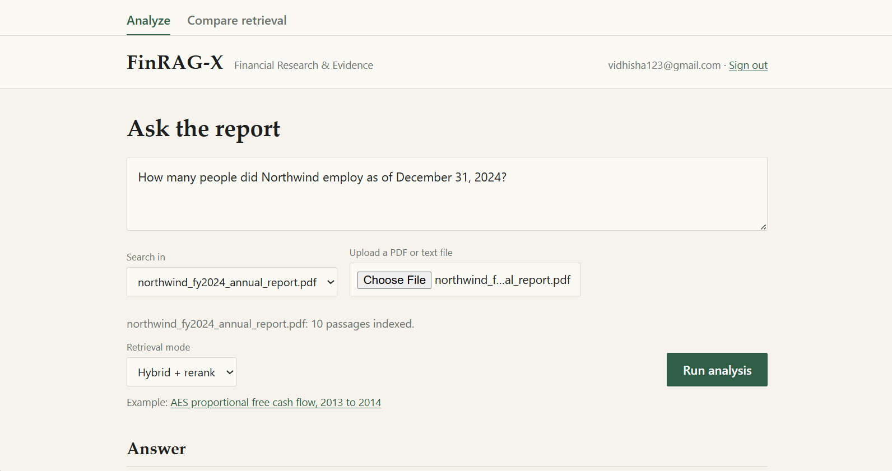

# FinRAG-X

**A citation-aware, numerically grounded RAG system for financial document question answering.**

Financial reports mix text, tables, footnotes, units and fiscal periods. A plain LLM or basic RAG pipeline can pick the wrong table column, do its own arithmetic incorrectly, cite sources that do not support the answer, or answer when the evidence is missing. FinRAG-X addresses this by combining hybrid retrieval, table-aware extraction, a calculation engine that runs in code, a verifier, and abstention.



## Research question

Can a financial-document-aware RAG pipeline with structured table handling, explicit numerical computation and answer verification improve answer reliability over a direct LLM and basic RAG?

This repository is a pilot study built around that question. Results are reported in [Evaluation](#evaluation), including what they do **not** show.

## Pipeline

```
Question → Route → Retrieve → Expand → Calculate → Generate → Verify → Answer (or abstain)
```

1. **Hybrid retrieval.** Dense embeddings (`BAAI/bge-small-en-v1.5`, FAISS) and BM25 are fused with reciprocal rank fusion, then reranked with a cross-encoder (`ms-marco-MiniLM-L-6-v2`).
2. **Page expansion.** Neighbouring chunks from the same report page are added as evidence.
3. **Table-aware extraction.** For metric and year questions, the matching table row and year columns are parsed directly from the retrieved table.
4. **Calculation engine.** Arithmetic runs in Python from a small program (`subtract`, `divide`, ...), not in the language model. For percentage-change questions the answer text is built from the computed value, so the model cannot change the number.
5. **Verifier with abstention.** The answer is released only if all checks pass:
   - an answer was produced
   - every cited id is among the retrieved evidence
   - calculation inputs appear in the evidence
   - the computed result appears in the answer
   - (when no calculation was run) every number in the answer appears in the evidence

   Failing answers are replaced by "Insufficient evidence to answer reliably."
6. **Question router (rule-based).** Labels each question as fact, numerical, comparison, multi-hop or risk. It is shown in the UI and does not change retrieval.
7. **Metadata filter (optional, off by default).** Restricts retrieval to the report matching the company and year in the question.
8. **Evidence-sufficiency heuristic (informational).** A keyword and company-name check returned in the API response. It does not affect the pass/fail decision.

## Application

- **Analyze:** ask a question and get the answer with clickable citations, the calculation steps, the verification checks, the question type, and an evidence viewer. Evidence tables are rendered as tables and the figures used in the calculation are highlighted.
- **Compare retrieval:** shows the top-5 passages returned by BM25, dense, hybrid and hybrid + rerank for the same question. No language model is called.
- **Evaluation:** shows the saved benchmark results (accuracy, abstention, retrieval, sufficiency). These are fixed benchmark results and do not change with uploaded documents.
- **Sign up and sign in:** SQLite storage, PBKDF2-hashed passwords, token sessions.
- **Document upload:** a PDF or text file is chunked, embedded and added to the live index. Questions can then be restricted to that document.

## Project structure

```
finrag-x/
├── backend/
│   ├── main.py          FastAPI app and endpoints
│   ├── auth.py          sign up / sign in
│   ├── pipeline.py      retrieval, filtering, router, upload indexing, answer_question()
│   ├── retrieval.py     BM25, dense, hybrid and reranked search
│   ├── engine.py        LLM calls, table extraction, program execution, verification
│   ├── chunks.py        builds data/chunks.json from the dataset
│   ├── config.py        model and dataset settings
│   ├── metrics.py       answer-matching helpers
│   ├── evaluate.py      evaluation of systems A-D (resumable)
│   ├── extra_metrics.py retrieval comparison (Recall@5 / @10)
│   ├── test_filter.py, test_router.py, test_sufficiency.py
│   └── requirements.txt
├── frontend/            React + TypeScript (Vite)
│   └── src/             App.tsx, Login.tsx, Extra.tsx, api.ts, App.css
├── data/                chunks, embeddings cache, evaluation outputs
└── docs/                screenshots
```

API endpoints: `/health`, `/signup`, `/login`, `/upload`, `/docs-list`, `/ask`, `/compare`, `/metrics`.

## Setup

Requirements: Python 3.10+, Node.js 18+, a Groq API key, and an internet connection for the first run (models and dataset are downloaded, then cached).

**Backend** (PowerShell, from the project root):

```powershell
cd backend
python -m venv .venv
.\.venv\Scripts\Activate.ps1
pip install -r requirements.txt
python chunks.py                      # first time only: builds data/chunks.json
$env:LLM_API_KEY = "<your Groq API key>"
uvicorn main:app --reload --port 8000
```

Wait for `Application startup complete.` The first start builds the embeddings, which takes longer; later starts use the cache.

**Frontend** (second terminal):

```powershell
cd frontend
npm install
npm run dev
```

Open http://localhost:5173, create an account, and ask a question.

**Model.** The default is `openai/gpt-oss-20b` through the Groq API. It can be changed with the `FINRAG_MODEL` environment variable. All reported results were produced with the default model.

**Secrets.** The API key is read from the `LLM_API_KEY` environment variable. Do not commit it, `data/users.db`, or `data/llm_cache/`.

## Example

**Question:** What was the percentage change in AES Corporation's proportional free cash flow between 2013 and 2014, as reported in the 2015 financial report?

**Answer:** The proportional free cash flow changed from $1,271 million in 2013 to $891 million in 2014, a percentage change of -29.90% `[D2204_C4]`.

**Calculation:** `subtract(891, 1271)`, then `divide(result of step 1, 1271)`. All verification checks passed.

## Evaluation

**Data.** FinQA subset of [T²-RAGBench](https://huggingface.co/datasets/G4KMU/t2-ragbench), indexed as 18,094 chunks. The accuracy evaluation uses a seeded random sample of **39 numeric questions** (`backend/evaluate.py`; per-question results in `data/eval_results_v2.csv`). An answer counts as correct if the gold number appears in it within a small tolerance.

**Systems compared**

| | Description |
|---|---|
| A | Direct LLM, no retrieval |
| B | Basic RAG: dense top-5, model calculates itself |
| C | Hybrid + rerank + page expansion, model calculates itself |
| D | C + calculation engine + verifier with abstention (FinRAG-X) |

### Answer accuracy (n = 39)

| System | Correct | Accuracy |
|---|---|---|
| A: Direct LLM | 3/39 | 7.7% |
| B: Basic RAG | 21/39 | 53.8% |
| C: Hybrid + rerank + page expansion | 18/39 | 46.2% |
| D: FinRAG-X (released and correct) | 15/39 | 38.5% |
| D before the verifier (raw answers) | 19/39 | 48.7% |

### Verification and abstention (answerable questions)

FinRAG-X abstained on 13 of 39 questions.

| Measure | Value |
|---|---|
| Abstention precision (refusals that blocked a wrong answer) | 9/13 = 69% |
| Abstention recall (wrong raw answers blocked) | 9/20 = 45% |
| False-refusal rate (correct raw answers blocked) | 4/19 = 21% |
| Accuracy of released answers | 15/26 = 57.7% (vs 48.7% before verification) |

### Retrieval comparison (50 random questions, no LLM calls)

Share of questions whose gold report page appears in the top-k results.

| Mode | Recall@5 | Recall@10 | Avg latency |
|---|---|---|---|
| BM25 | 88% | 94% | 0.57 s |
| Dense | 94% | 94% | 0.45 s |
| Hybrid (rank fusion) | 94% | 98% | 0.43 s |
| Hybrid + rerank | 94% | 98% | 5.13 s |

Recall is matched by context id, so it is conservative when the same page appears under more than one id. In the 39-question run, the gold page was in the top 5 for 38/39 (B, dense) and 37/39 (D).

### Metadata filter

Company and year parsed from the question triggered the filter on 34 of 39 questions. The gold page was in the top 5 for 36/39 questions both with and without the filter: no loss, and no measured gain on this sample.

### By question type (rule-based router)

| Type | n | D correct | B correct |
|---|---|---|---|
| numerical | 28 | 12 | 16 |
| multi-hop | 5 | 2 | 2 |
| fact | 3 | 0 | 2 |
| comparison | 2 | 1 | 1 |
| risk | 1 | 0 | 0 |

Groups other than "numerical" are too small for conclusions. The router labels a question multi-hop when it names three or more years, which is a crude rule.

### Evidence-sufficiency heuristic (retrieval only, 39 questions)

Unanswerable cases were simulated by removing the gold page from the retrieved evidence.

| Measure | Value |
|---|---|
| Answerable questions judged sufficient | 39/39 |
| False-refusal rate | 0/39 |
| Unanswerable (gold page removed) flagged insufficient | 2/39 |

The check never blocked an answerable question but detected almost none of the simulated unanswerable cases. Removing the gold page leaves other pages of the same company in the evidence, and these share most of the question's keywords. Detecting this needs content-level checks or a trained classifier.

### Findings

- **Retrieval is the clearest effect.** Accuracy rises from 7.7% (no retrieval) to 53.8% (basic RAG).
- **B, C and D cannot be separated.** With 39 questions the 95% intervals are about ±15 points, so this pilot does not show that FinRAG-X, hybrid retrieval or the verifier improves raw accuracy over basic RAG.
- **The verifier trades coverage for precision.** It releases fewer answers, and a larger share of the released answers are correct (57.7% vs 48.7%), at the cost of refusing 4 correct answers.
- **Reranking adds about 10x latency** (5.1 s vs 0.4 s) with no recall gain at the page level on this corpus.

### Error analysis

1. **Wrong calculator inputs (2 cases).** Correctly refused by the verifier.
2. **Correct answers refused (3 cases).** The model's own arithmetic (for example 145.29 - 33.87 = 111.42) is not present verbatim in the evidence, so the "numbers supported" check fails. This is a deliberately conservative design.
3. **False accept (`finqa_test_119`).** All checks passed on an incorrect answer. The verifier checks grounding, not correctness.
4. **"Insufficient evidence" despite relevant retrieval (3 cases).** Model variance on the answer step.

## Limitations

- **Small pilot evaluation (n = 39).** No significance claims are made between B, C and D. The planned 200-300 question benchmark was not built.
- **Abstention on unanswerable questions** was tested only by removing the gold page and applying a keyword heuristic, not on a hand-written unanswerable set.
- **Citation quality was not measured reliably.** An attempt to match cited chunk ids against the index gave inconsistent results, so no figures are reported. The verifier requires every cited id to be among the retrieved evidence, and the UI shows each cited chunk with the relevant figures highlighted. Claim-level faithfulness is not checked.
- **The table parser** covers a fixed list of metrics, and code-built answers cover percentage-change questions only. Other numeric questions rely on LLM-generated programs.
- **The verifier cannot confirm arithmetic** that the calculation engine did not produce, and it checks grounding rather than correctness.
- **Uploaded documents** are indexed as plain text, so table structure is lost and the calculation engine does not apply. Uploads are held in memory and cleared when the backend restarts. They are not scored by the Evaluation tab.
- **Authentication is demo-grade:** no email verification, session expiry or rate limiting.
- **Throughput** is limited by the free-tier token quota of the model API, which can cause long waits or "rate-limited" errors.

## Not implemented

MCP tool access, trained question and evidence-sufficiency classifiers, claim-level citation verification, a 200-300 question custom benchmark, an SEC EDGAR filing corpus, and PDF viewing with bounding boxes.

## Related work

FinQA, TAT-QA, MultiHiertt (financial numerical QA); DocFinQA (long documents); ALCE (citations); Self-RAG and CRAG (verification). Verify venues and years before citing.
